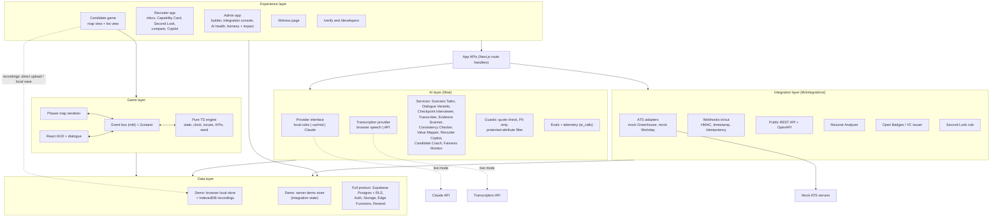

# Architecture

Five layers. The demo build is local-first: the Data layer is the browser's local store plus an in-process demo store on the server, and the AI layer runs on deterministic local providers unless `AI_MODE=live` and a key are set in the environment. The full-product targets (Supabase, Claude, a transcription API, Resend) are shown as the swap-in providers.

## Rules the architecture enforces

- Phaser only renders and sends input. All game logic is in the pure TypeScript engine, unit-tested without a canvas.
- Nothing outside `lib/ai` calls a model. Every call goes through a guard (PII in, quotes and protected attributes out) and is logged.
- The Final score sorts, never filters. There is no threshold anywhere in the inbox or API.
- No secrets in code. Live providers read keys from the environment only.
